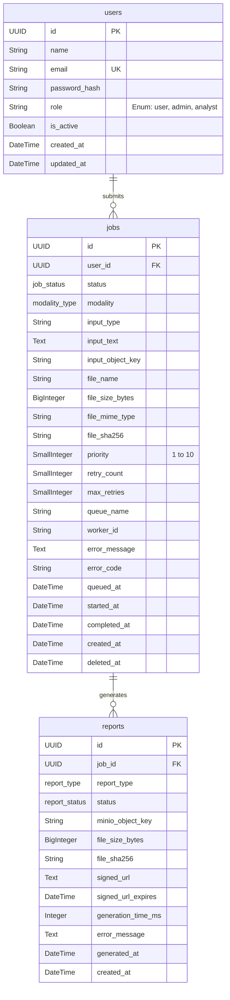

# Sprint 1 Database Schema

Based on the Sprint 1 setup (as defined in the `001_initial_migration.py` Alembic migration and the models in `shared/db`), the following is the database schema for the core infrastructure.

## Entity-Relationship Diagram

## Tables Overview

### 1. `users`
- Handles the core authentication schema, storing the user's `email` and Argon2-encrypted `password_hash`. 
- A `role` column uses a check constraint allowing only `'user'`, `'admin'`, or `'analyst'`.

### 2. `jobs`
- Tracks inference requests submitted by users, linked via `user_id`.
- Supports different input configurations (validated by constraints), storing either raw `input_text` for text detection or an `input_object_key` representing a file in MinIO (for images/audio/video).
- Core ENUMs defined in PostgreSQL:
    - `job_status`: `'queued'`, `'processing'`, `'completed'`, `'failed'`, `'cancelled'`
    - `modality_type`: `'text'`, `'image'`, `'audio'`, `'video'`, `'multimodal'`
- Tracks telemetry, metadata, error details, and timeline information (queued, started, completed).

### 3. `reports`
- Represents the resulting forensics and analysis output tied to a completed `job`.
- `report_type` ENUM: `'pdf'`, `'json'`, `'html'`
- `report_status` ENUM: `'pending'`, `'generating'`, `'completed'`, `'failed'`
- Contains a unique combination constraint on `job_id` and `report_type` so each job only generates one report of a specific type.
- Points to the finalized report payload living in object storage (`minio_object_key` / `signed_url`).
